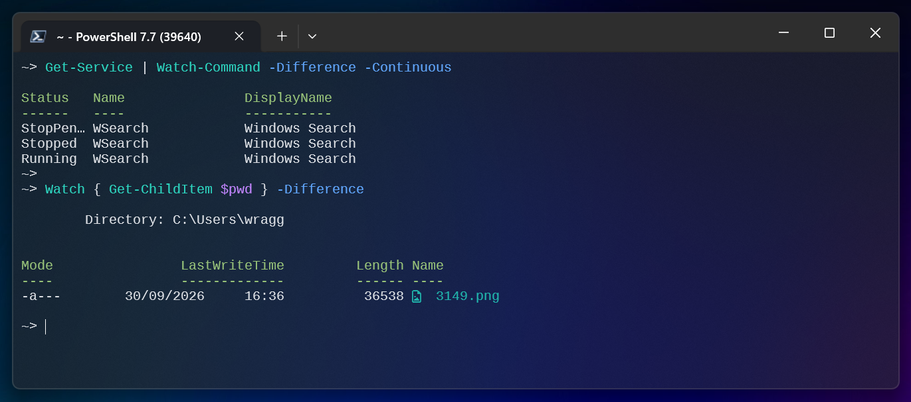
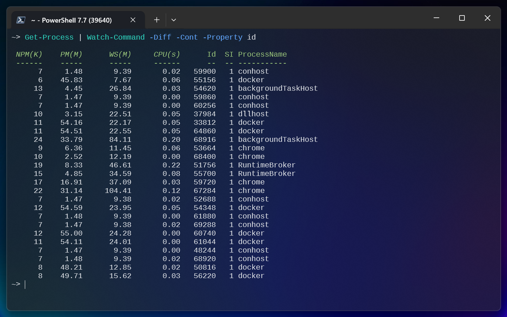
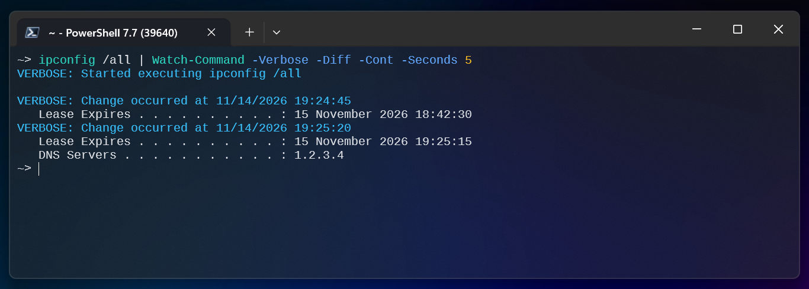

# PowerShell-Watch

[](https://www.powershellgallery.com/packages/watch)

[](https://github.com/markwragg/PowerShell-Watch/actions/workflows/build.yml)

[](https://www.powershellgallery.com/packages/watch)
[](https://www.powershellgallery.com/packages/watch)

This PowerShell module contains a `Watch-Command` cmdlet that repeatedly runs a PowerShell command or scriptblock and returns its output when it has changed.



## Installation

The module is published in the PowerShell Gallery and works with Windows PowerShell 5.1 and PowerShell 7+. Install it by running:

```powershell
Install-Module Watch
```

Or:

```powershell
Install-PSResource Watch
```

## Cmdlets

The module includes the following cmdlets / aliases:

Cmdlet          | Description
----------------|-------------------------------------------------------------------------------
`Watch-Command` | Runs a scriptblock or the preceding pipeline repeatedly until there is change.
`watch`         | Alias for `Watch-Command`
`wc`            | Alias for `Watch-Command`

> [!NOTE]
> On Linux and macOS, PowerShell aliases take precedence over native commands, so while this module is imported `watch` and `wc` will run `Watch-Command` rather than the native `watch` and `wc` (word count) utilities. Use the full path (e.g. `/usr/bin/wc`) to run the native commands, or unload the module (`Remove-Module Watch`).

## Parameters

`Watch-Command` (aliases: `watch`, `wc`) has the following parameters:

Parameter        | Description
-----------------|----------------------------------------------------------------------------------
`-ScriptBlock`   | The scriptblock to run. Can be omitted when using the [pipeline shorthand](#pipeline-shorthand).
`-Seconds`       | Number of seconds to wait between checks. Default: `1`.
`-Difference`    | Output only the items that have been added or changed.
`-ChangeSummary` | Output each change as an object describing what was added, removed or modified.
`-Key`           | One or more properties that uniquely identify an item, used to detect modifications. Implies `-ChangeSummary`.
`-Continuous`    | Keep running after a change has occurred, until interrupted with CTRL+C.
`-AsString`      | Convert the result into an array of strings before comparing.
`-ClearScreen`   | Clear the screen before each change is output. Alias: `-cls`.
`-PassThru`      | Return the initial result immediately, before any change has occurred.
`-Property`      | One or more property names to compare. Use `*` for all properties.

Some parameters can't be combined. These rules are enforced by parameter sets, so `Get-Help Watch-Command` shows each valid combination:

- `-ChangeSummary` and `-Difference` are mutually exclusive.
- `-Key` implies `-ChangeSummary`, so it can't be used with `-Difference` either.
- `-Key` can't be used with `-AsString`.

See [Documentation/Watch-Command.md](Documentation/Watch-Command.md) or run `Get-Help Watch-Command -Full` for the full reference.

## Usage

Provide `Watch-Command` with a ScriptBlock:

```powershell
Watch-Command -ScriptBlock { Get-Process }
```

By default the ScriptBlock is run every 1 second, and its output is returned in full once it has changed from the first iteration. You can change the interval between checks via the `-Seconds` parameter.

### Pipeline shorthand

If `Watch-Command` receives any pipeline input other than a ScriptBlock, it treats the commands that preceded it in the pipeline as the ScriptBlock to run. This means you can quickly add `| Watch-Command` (or its aliases `| watch` or `| wc`) to the end of an existing command:

```powershell
Get-Service | wc
```

> [!NOTE]
> The shorthand works by re-reading the source of the command, and re-runs only the commands that are piped into `Watch-Command`. Anything else on the line, such as an assignment (`$Result = ...`) or an earlier statement separated by `;`, is not re-run. In a script, a pipeline can span several lines. When typed interactively, a multi-line pipeline is only supported on PowerShell 7.4 and later. If the shorthand can't work out the piped commands, it says so, and you can use `-ScriptBlock { ... }` instead.

### Continuous and difference mode

- `-Continuous` keeps running (until interrupted via CTRL+C), returning output each time a change occurs.
- `-Difference` returns only the objects in a collection that have been added or changed (it does not report removed items, see [Change summaries](#change-summaries) for that).
- `-Verbose` writes a timestamp before each change is output, which is particularly useful alongside `-Continuous` and `-Difference`.
- `-ClearScreen` (alias `-cls`) clears the console before each change is output.
- `-PassThru` returns the initial result immediately, before any change has occurred.

For example:

```powershell
Get-Service | Watch-Command -Difference -Continuous -Verbose
```

This command continually outputs services each time one of their default properties changes, with a verbose timestamp above each change showing when it occurred:

> [!TIP]
> PowerShell lets you shorten parameter names as long as they remain unambiguous, so `-Diff -Cont` works as well as `-Difference -Continuous`.

#### Keeping the output after CTRL+C

`-Continuous` only stops when you press CTRL+C, which also stops the assignment in `$Changes = ... | Watch-Command -Continuous`, so the variable is left empty. To keep everything that was output, use the common parameter `-OutVariable` (alias `-ov`) instead. It collects each object as it's output, so it still has every change after you press CTRL+C, while the output still appears in the console as usual:

```powershell
Get-ChildItem C:\Temp | Watch-Command -ChangeSummary -Key Name -Continuous -OutVariable Changes

# After pressing CTRL+C:
$Changes | Where-Object ChangeType -eq 'Removed'
```

Give the variable name without the `$`. Prefix it with `+` (e.g. `-OutVariable +Changes`) to add to the variable's existing contents instead of replacing them, for example across several watch sessions.

### Change summaries

`-ChangeSummary` reports each change as a clean object instead of the raw output, and unlike `-Difference` it also reports items that were removed. Each object has the following properties:

Property          | Description
------------------|------------------------------------------------------------------
DetectedAt        | When the change was detected, as a `[datetime]`. This can be up to `-Seconds` after the change actually happened. Every change found in the same check has the same value.
ChangeType        | `Added`, `Removed` or `Modified`.
Key               | The value of the `-Key` property (or properties) for the item, if `-Key` was specified.
ChangedProperties | For `Modified` changes, the names of the properties that changed.
Changes           | For `Modified` changes, one entry per changed property, with its `Property` name, `PreviousValue` and `CurrentValue`.
PreviousItem      | The whole item as it was before the change (`$null` for `Added`).
CurrentItem       | The whole item as it is after the change (`$null` for `Removed`).

Use `-Key` to name one or more properties that uniquely identify an item (e.g. `Name` or `Id`). Items are then paired up by key between checks, so an in-place change is reported as `Modified` (with the specific properties that changed) rather than as an unrelated removal and addition. Without `-Key`, changes are only reported as `Added` or `Removed`. `-Key` turns on `-ChangeSummary` by itself, so `-Key Name` on its own does the same as `-ChangeSummary -Key Name`.

Key values are compared case-sensitively, so items whose keys differ only by case are treated as different items. (Detecting whether anything has changed at all ignores case, though, so renaming a file by only changing its case isn't reported by itself.) The key should be unique to each item. If several items share a key value (for example `Get-Process` with `-Key Name`, where many processes are called `svchost`), changes to them can't be paired up, so they're reported as `Removed` and `Added` rather than `Modified`, and a warning is shown. Use a unique property, such as `-Key Id`, or several properties together (`-Key Name, Id`) to avoid this.

For example:

```powershell
Get-ChildItem C:\Temp | Watch-Command -ChangeSummary -Key Name -Continuous
```

This monitors a folder and reports each file that is added, removed or modified, including which properties changed and their previous and current values.

By default, change summaries are shown as a table with `Time` (the time part of `DetectedAt`), `ChangeType`, `Key`, `ChangedProperties` and `Item` columns, and each row appears as soon as the change is detected. Use `Format-List` to see every property, including the before and after values in `Changes`:

```powershell
Get-ChildItem C:\Temp | Watch-Command -ChangeSummary -Key Name -Continuous | Format-List
```

To see the before and after values of a change as a table, expand `Changes`:

```powershell
$Change = Get-ChildItem C:\Temp | Watch-Command -Key Name
$Change.Changes

Property      PreviousValue        CurrentValue
--------      -------------        ------------
Length        5                    10
LastWriteTime 17/11/2026 17:48:26  17/11/2026 17:52:03
```

### Choosing which properties to compare

`Watch-Command` uses `Compare-Object` to compare each result with the previous one. Which properties are compared is decided as follows:

1. If you specify `-Property`, only those properties are compared.
2. Otherwise, if the object has a default display property set (the properties shown by default in the console), those properties are compared.
3. Otherwise, all of the object's regular properties are compared. Computed members, such as script properties, are excluded because they are evaluated live and can throw errors (for example on a file that has since been deleted). `LastAccessTime` and `LastAccessTimeUtc` are also excluded. Simply reading a file updates them, and Windows only updates the copy that `Get-ChildItem` sees at some later point, so they would report changes at seemingly random times. Name them with `-Property` if you do want to watch them.

You can force the use of all properties by specifying `-Property *`.

```powershell
Get-Process | Watch-Command -Difference -Continuous -Property Id
```



This command continually outputs processes each time the set of process IDs changes (e.g. a new process has started).

### Native commands

You can also use `Watch-Command` to monitor non-PowerShell command output, which is generally treated as strings. Here's an example of monitoring the output of `ipconfig /all` for a change to the DNS server addresses:

```powershell
ipconfig /all | Watch-Command -Verbose -Difference -Continuous -Seconds 5
```



To force `Watch-Command` to treat the result of any command as an array of strings, regardless of the object type returned, use the `-AsString` parameter.
